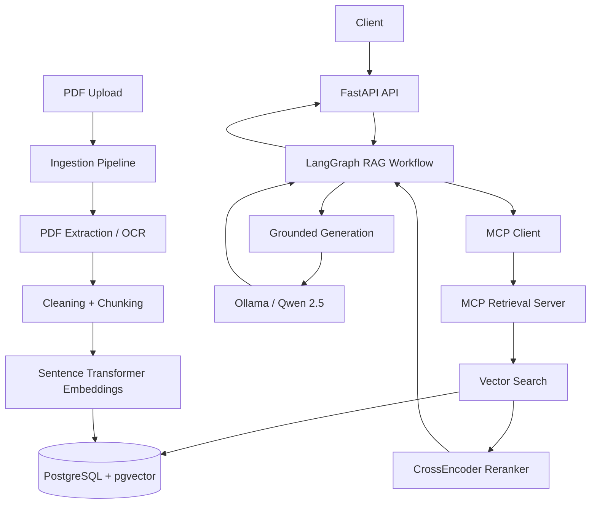

# Agentic RAG Data Platform

A production-style Retrieval-Augmented Generation (RAG) platform built with FastAPI, PostgreSQL + pgvector, LangGraph, MCP, local LLMs, Docker, Kubernetes, automated testing, CI, and structured observability.

The system ingests PDF documents, extracts and chunks text, stores vector embeddings, retrieves and reranks relevant passages, and generates grounded answers with source citations.

## Features

- PDF ingestion with OCR fallback for scanned or image-heavy pages
- Text cleaning and recursive chunking
- Sentence Transformer embeddings
- PostgreSQL + pgvector vector storage
- Semantic similarity search
- CrossEncoder reranking
- Grounded answer generation with local Ollama models
- Source citations linked to retrieved document chunks
- LangGraph-based conditional RAG workflow
- Model Context Protocol (MCP) retrieval service
- FastAPI REST API
- Docker and Docker Compose support
- Local Kubernetes deployment
- Automated tests with pytest
- GitHub Actions continuous integration
- Structured application logging and performance timing

## Architecture



### RAG request flow

1. A question is submitted to the FastAPI `/ask` endpoint.
2. LangGraph starts the retrieval workflow.
3. The MCP client invokes the document-search tool exposed by the MCP server.
4. The query is embedded and compared against document vectors stored in pgvector.
5. Candidate chunks are reranked using a CrossEncoder.
6. LangGraph evaluates retrieval quality.
7. If retrieval quality is sufficient, the retrieved context is passed to the generation model.
8. If retrieval quality is poor, LangGraph can rewrite the query and retry retrieval.
9. Qwen generates an answer constrained to the retrieved context.
10. Only cited document chunks are returned as sources.

## Technology Stack

| Area | Technology |
|---|---|
| API | FastAPI |
| Workflow orchestration | LangGraph |
| Agent/tool protocol | Model Context Protocol (MCP) |
| Database | PostgreSQL |
| Vector storage | pgvector |
| Embeddings | `all-MiniLM-L6-v2` |
| Reranking | `cross-encoder/ms-marco-MiniLM-L-6-v2` |
| Generation | Qwen 2.5 7B via Ollama |
| Query rewriting | Llama 3.2 3B via Ollama |
| PDF processing | pypdf, PyMuPDF |
| OCR | Tesseract OCR |
| Testing | pytest |
| Containers | Docker, Docker Compose |
| Orchestration | Kubernetes |
| CI | GitHub Actions |
| Observability | Python structured logging |

## Project Structure

```text
agentic-rag-platform/
├── app/
│   ├── core/
│   │   └── logging_config.py
│   ├── database/
│   │   ├── connection.py
│   │   ├── init_db.py
│   │   └── models.py
│   ├── embeddings/
│   │   ├── backfill.py
│   │   └── model.py
│   ├── generation/
│   │   └── service.py
│   ├── ingestion/
│   │   ├── chunker.py
│   │   ├── cleaner.py
│   │   ├── ocr_loader.py
│   │   ├── pdf_loader.py
│   │   └── service.py
│   ├── mcp/
│   │   ├── client.py
│   │   └── server.py
│   ├── retrieval/
│   │   ├── reranker.py
│   │   ├── search.py
│   │   └── service.py
│   ├── workflow/
│   │   └── rag_graph.py
│   └── main.py
├── tests/
├── k8s/
├── .github/workflows/
├── Dockerfile
├── docker-compose.yml
├── requirements.txt
└── .env.example
```

## API Endpoints

### Health check

```http
GET /health
```

### Database health check

```http
GET /db-health
```

### Upload a PDF

```http
POST /documents/upload
```

The document is extracted, cleaned, chunked, embedded, and stored in PostgreSQL.

### Ask a question

```http
POST /ask
Content-Type: application/json
```

Example request:

```json
{
  "question": "How many LP are required for the Master Thesis?"
}
```

Example response:

```json
{
  "answer": "30 LP\n\n[Source: Info_Slides.pdf (chunk 12)]",
  "sources": [
    {
      "document": "Info_Slides.pdf",
      "chunk_index": 12
    }
  ]
}
```

## Local Setup

### 1. Clone the repository

```bash
git clone https://github.com/saudkhan435/agentic-rag-platform.git
cd agentic-rag-platform
```

### 2. Create a virtual environment

```bash
python3 -m venv .venv
source .venv/bin/activate
```

### 3. Install dependencies

```bash
pip install -r requirements.txt
```

### 4. Configure environment variables

Copy the example configuration:

```bash
cp .env.example .env
```

Then update `.env` with the required local database settings.

### 5. Start PostgreSQL

The Docker Compose configuration provides PostgreSQL with pgvector support.

```bash
docker compose up -d db
```

### 6. Initialize the database

```bash
python -m app.database.init_db
```

### 7. Start Ollama

Install Ollama and make sure the required models are available:

```bash
ollama pull qwen2.5:7b
ollama pull llama3.2:3b
```

### 8. Start the API

```bash
uvicorn app.main:app --reload
```

The API will be available at:

```text
http://localhost:8000
```

Interactive FastAPI documentation is available at:

```text
http://localhost:8000/docs
```

## Docker

The API and PostgreSQL can also be started with Docker Compose:

```bash
docker compose up --build
```

Ollama runs on the host machine and is accessed from the application container.

## Kubernetes

Kubernetes manifests are provided in the `k8s/` directory.

```bash
kubectl apply -f k8s/deployment.yaml
kubectl apply -f k8s/service.yaml
```

The project has been tested using Docker Desktop's local Kubernetes cluster.

The Kubernetes deployment runs the RAG application inside the cluster while PostgreSQL and Ollama remain external local services.

## Testing

Run the automated test suite with:

```bash
pytest tests -v
```

The current test suite covers:

- API health endpoints
- API input validation
- document cleaning
- LangGraph routing decisions
- mocked RAG API execution

## Continuous Integration

GitHub Actions automatically runs the test suite on pushes and pull requests.

The CI pipeline:

1. checks out the repository,
2. configures Python,
3. installs project dependencies,
4. runs the pytest suite.

This project currently implements **continuous integration (CI)**, not continuous deployment.

## Observability

The application uses centralized structured logging for important pipeline stages, including:

- HTTP requests
- LangGraph workflow execution
- routing decisions
- MCP calls
- vector retrieval
- reranking
- LLM generation
- execution duration
- error tracebacks

Example:

```text
INFO | app.mcp.client | MCP search completed | results=5 | duration=29.54s
INFO | app.workflow.rag_graph | Retrieval evaluated | best_score=4.5585 | threshold=-3.0000 | good=True
INFO | app.workflow.rag_graph | Routing decision | route=generate | retries=0
INFO | app.generation.service | LLM generation completed | model=qwen2.5:7b | duration=35.26s | sources=1
INFO | app.main | HTTP request completed | method=POST | path=/ask | status=200 | duration=70.26s
```

Sensitive configuration values and document contents are not written to application logs.

## Engineering Challenges

### OCR fallback

Some PDFs contain pages where standard text extraction produces little usable text. The ingestion pipeline detects these cases and falls back to Tesseract OCR.

This improves support for scanned documents, although OCR can lose complex table formatting.

### Retrieval quality

Vector similarity alone did not always return the most relevant passages. The retrieval pipeline therefore uses two stages:

1. vector search to retrieve candidates,
2. CrossEncoder reranking to improve final relevance.

### Conditional RAG workflow

Retrieval quality is evaluated inside LangGraph. Low-quality retrieval can trigger a query-rewrite path instead of immediately sending weak context to the LLM.

### MCP environment isolation

The MCP retrieval server runs as a separate stdio subprocess. Environment variables such as the database connection string must therefore be explicitly passed to the MCP process.

### Local Kubernetes image handling

Docker Desktop Kubernetes uses its own container runtime. The locally built application image had to be imported into the Kubernetes runtime before the deployment could use it.

### End-to-end latency

The current implementation starts a new MCP subprocess for each retrieval request. This provides clear architectural separation but introduces additional startup and model-loading latency.

In one local test, an end-to-end request took approximately 70 seconds, with roughly 30 seconds spent in the MCP retrieval path and 35 seconds in local LLM generation. These timings are hardware-dependent.

A persistent MCP process and optimized model serving would significantly reduce this overhead.

## Current Limitations

- MCP retrieval currently starts a subprocess for each request.
- Local LLM inference can be slow on limited hardware.
- OCR may not preserve complex table layouts.
- The retrieval relevance threshold is experimentally configured rather than dynamically calibrated.
- PostgreSQL and Ollama remain outside the Kubernetes cluster in the current local deployment.
- Cloud deployment is not included in the current implementation.

## Future Improvements

Possible extensions include:

- persistent MCP connections
- request tracing with correlation IDs
- Prometheus-compatible metrics
- improved retrieval evaluation
- automated database migrations
- authentication and authorization
- asynchronous ingestion jobs
- model-serving optimization
- managed cloud deployment

## Security and Repository Hygiene

Secrets and private documents are excluded from version control.

The repository includes `.env.example` for configuration documentation while the real `.env` file remains ignored.

Uploaded and local PDF files under `data/` are also excluded from Git.

## License

This project is intended as a portfolio and educational project.